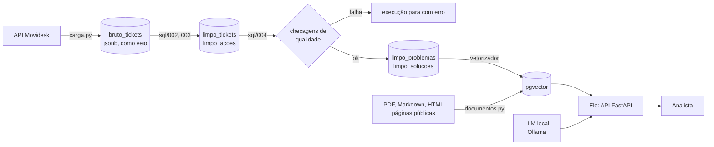

# Elo — Copiloto de Suporte

Copiloto para analistas de suporte de um ERP (TOTVS Protheus), construído sobre os chamados reais
atendidos no Movidesk. Pipeline de dados, busca semântica, triagem por vizinhos e rascunhos de
resposta gerados por um LLM que roda na própria máquina.

> **Dados e anonimização.** O projeto roda sobre dados reais de uma empresa, com autorização.
> **Nenhum dado de cliente está neste repositório:** aqui estão só o código, o SQL, a documentação
> e números agregados. Nomes de produtos e de clientes foram substituídos por genéricos
> (`Produto A`, `Produto B`, `ACME`), inclusive em comentários e testes.

## O problema

No suporte, cada ticket novo passa por uma triagem manual: escolher categoria e urgência, entender o
problema e procurar como casos parecidos foram resolvidos antes. Esse conhecimento fica espalhado nas
conversas de tickets antigos e depende da memória de quem atende.

## Escopo

**Dados.** Coletar os tickets e as conversas, organizar num banco de dados e garantir que estejam
atualizados e confiáveis.

**Análise e inferência: entender o porquê.** Descobrir o que explica o comportamento do suporte,
separando efeito real de acaso:

- o que leva um ticket a estourar o SLA (categoria, urgência, cliente, dia e horário de abertura);
- quanto tempo cada tipo de ticket leva para ser resolvido, e com que incerteza;
- se as diferenças entre grupos são estatisticamente significativas, e de que tamanho são.

**Produto.** Uma ferramenta de apoio ao analista que, quando um ticket chega, mostra os casos
parecidos já resolvidos, sugere categoria e urgência, indica o risco de estourar o SLA e propõe um
rascunho de resposta — sempre revisado pelo analista antes de ser enviado.

## Arquitetura em uma figura



Detalhe dos componentes e do fluxo: [docs/arquitetura.md](docs/arquitetura.md).

## O pipeline de dados

Coleta os tickets da API do Movidesk, guarda no PostgreSQL, organiza em tabelas prontas para análise
e confere a qualidade dos dados a cada execução. Roda sozinho de hora em hora.

| Tabela | Conteúdo |
|---|---|
| `bruto_tickets` | Um ticket por linha, exatamente como a API devolveu (`jsonb`). Nunca é alterado pelo tratamento. |
| `limpo_tickets` | Um ticket por linha, com tipos corretos e datas com fuso. |
| `limpo_acoes` | Uma linha por mensagem do ticket, com autor (agente ou cliente) e visibilidade (pública ou interna). |
| `limpo_problemas` | O texto do problema de cada ticket: assunto + mensagens públicas do cliente. |
| `limpo_solucoes` | A solução de cada ticket resolvido: última mensagem pública do agente e nota técnica. |
| `docs_trechos` | Trechos da base de conhecimento com embedding (`vector(768)`, índice HNSW). |

Cerca de 2,4 mil tickets e 11,4 mil mensagens, de março a setembro de 2026.

### Decisões

**O dado bruto é guardado antes de qualquer tratamento.** A API do Movidesk só devolve a versão atual
de cada ticket. Guardar o retorno original em `jsonb` permite refazer o tratamento a partir do banco
quando uma regra mudar, sem chamar a API de novo. O tratamento é feito em SQL, versionado em `sql/`.

**A carga busca só o que mudou.** A primeira execução busca o histórico completo (cerca de 40
páginas). As seguintes buscam só os tickets atualizados desde a última carga, normalmente em uma
requisição. A busca começa 30 minutos antes desse ponto, porque a API leva alguns minutos para
refletir as mudanças.

**Rodar de novo não duplica nada.** A gravação é um upsert que só substitui um ticket quando a versão
recebida é mais nova que a gravada.

**Falhas da API são tratadas.** A API aceita 10 requisições por minuto e bloqueia por mais tempo a
cada sequência de erros. A paginação espera 6 segundos entre páginas, e timeouts, `429` e erros `5xx`
têm até 3 novas tentativas com espera crescente, obedecendo o cabeçalho `retry-after`. Erros que não
adianta repetir, como `401`, param na hora.

**As tabelas tratadas nunca ficam pela metade.** Cada arquivo `.sql` roda numa única transação. Se
algo falhar, a versão anterior das tabelas continua valendo.

**Toda execução confere os dados.** `004_checagens.sql` verifica se as tabelas batem entre si, se há
datas no futuro, mensagens anteriores à abertura do ticket, tickets fechados sem categoria e se os
dados estão parados há mais de 3 dias. Qualquer problema encerra a execução com erro.

### O que os dados mostraram

- **A documentação não bate com a API.** Pela documentação, a rota `/tickets/past` traria só tickets
  parados há mais de 90 dias. Na prática ela devolve quase todos, inclusive os recentes. A carga
  busca nas duas rotas e remove duplicados pelo `id`, mantendo a versão mais nova.
- **Os tickets sem categoria não são erro.** São tickets cancelados antes da triagem ou ainda não
  triados. Nenhum ticket foi fechado sem categoria, e isso virou uma checagem permanente.
- **Tickets internos são exceção.** São 39, com uso esporádico entre março e julho. Mensagens
  internas nunca entram em respostas ao cliente.
- **O id da mensagem se repete entre tickets.** Ele é sequencial dentro de cada ticket, por isso a
  chave de `limpo_acoes` é `(ticket_id, acao_id)`.
- **A senha funcionava no DBeaver e falhava no Python.** No Windows, a libpq lê variáveis de ambiente
  na codificação do sistema, o que alterava um caractere não ASCII da senha. A correção foi passar a
  senha diretamente ao `psycopg.connect`.

### Limitações conhecidas

- O tipo do ticket (interno ou público) não é coletado, porque tickets internos são raros.
  Adicionar o campo exigiria reprocessar o histórico.
- As checagens rodam depois de as tabelas tratadas serem atualizadas. O ideal seria conferir numa
  tabela temporária e só então substituir as oficiais.
- A execução agendada depende da máquina ligada.

## O copiloto

Aplicação web com login e papéis (analista, gestor, admin). Roda inteira na máquina do time, com
embeddings locais (EmbeddingGemma, CPU) e um LLM local (Ollama, `qwen2.5:7b`, GPU). **Nenhum texto de
ticket sai para um serviço de IA externo.**

| Tela | O que faz |
|---|---|
| Fila | Tickets abertos do analista (ou do time), com módulo e urgência sugeridos, risco de SLA e o tipo de rascunho. Urgentes e com risco primeiro. |
| Ticket | Problema com dados pessoais mascarados; sugestões com confiança; prazo; rascunho; os 5 casos resolvidos mais parecidos; "Pergunte sobre este ticket". |
| Rascunho | **De solução** quando o caso mais parecido passa do limiar (0,80, ajustável) e os vizinhos concordam no módulo; senão, **de análise** (o que pode ser, o que perguntar, onde olhar). Gerado em segundo plano, um por vez na GPU. |
| Pergunte | RAG sobre tickets resolvidos e a base de conhecimento (PDFs, páginas públicas), com busca híbrida (vetor + BM25). Toda resposta cita as fontes, ou diz "não encontrei". |
| Base de conhecimento | Envio de PDF, Markdown, TXT e HTML; cada documento entra no RAG só quando gestor ou admin liga "Usar no RAG". |
| Acessos | Credenciais de acesso aos ambientes dos clientes, com a senha cifrada (Fernet) e registro de quem revelou cada uma. |
| Painel | Tempo até resolver, SLA cumprido, por analista; uso e avaliação dos rascunhos. |
| Configurações | Limiar, fontes, usuários, papéis e desempenho. |

### Triagem por vizinhos (kNN)

Módulo, urgência e risco de SLA vêm dos 10 tickets resolvidos mais parecidos, do mesmo produto. A
[avaliação temporal](docs/avaliacao_triagem.md) usa só o que existia quando cada ticket foi aberto
(570 tickets, 60 dias):

- **Módulo:** 65% de acerto contra 36% chutando o mais comum; com confiança ≥ 90%, acerta 92%.
- **Urgência:** 66%, igual à linha de base. Só ajuda quando a confiança é alta, e a tela avisa.
- **Risco de SLA:** AUC 0,84. Dos marcados como risco alto, 14% estouraram, contra 1% dos de risco
  baixo (média geral: 4,6%). As porcentagens brutas dos vizinhos superestimam o risco, por isso a
  tela mostra a taxa medida.

### Avaliação do Pergunte

O RAG é medido antes de qualquer mudança em busca, trechos ou prompt, com perguntas cuja resposta
certa foi conferida na documentação, e um conjunto de validação separado que não é usado para
ajustar nada. Linha de base 11/22; depois da busca híbrida, das linhas de tabela e do bloco "fontes
úteis", 22/22 no conjunto de ajuste e 11/13 no de validação, sem código inventado.

### Desempenho

Cada rota é cronometrada (`Server-Timing`), separando banco, vetor e LLM. Medição em uma bateria de
uso real (RTX 3050 6 GB, banco gerenciado na nuvem):

| O quê | Antes | Depois |
|---|---|---|
| Fila | 5,6 s (20 s no time todo) | 16–90 ms |
| Ticket | 4–5 s | 4–7 ms |
| Pergunte: até a 1ª palavra | 17–33 s | 0,7–2 s (streaming) |
| Pergunte: total | 17–33 s | ~8 s |
| Rascunho na hora: 1ª palavra | 25–45 s | ~2,7 s (streaming) |
| Rascunho já pronto | 2–3 s | ~10 ms |

Cada ida ao banco custa ~300 ms. A fila aberta vive num retrato em memória atualizado a cada 2 min; a
API usa autocommit; login e configuração ficam em cache; o LLM escreve em streaming e a pré-geração
cede a GPU na hora para quem está esperando.

## Segurança e privacidade

- **Credenciais** ficam no `.env`, fora do Git. O token do Movidesk vai na URL da API, então nenhuma
  mensagem de erro imprime a URL, e a configuração tem `repr=False` no token.
- **Senhas de usuário:** `scrypt` com sal aleatório, comparação em tempo constante.
- **Sessões:** token de 32 bytes aleatórios; o banco guarda só o `sha256` dele. Cookie `HttpOnly`,
  `SameSite=Lax`, `Secure` fora do localhost, 12 h de validade. Trocar a senha encerra as outras
  sessões.
- **Autorização:** todas as rotas exigem sessão; as destrutivas exigem papel `gestor` ou `admin`.
- **Dados pessoais** (e-mail, CPF, CNPJ, telefone, nome na saudação) são mascarados antes de o texto
  ser exibido ou enviado ao LLM.
- **Senhas de acesso aos clientes** são cifradas com Fernet; a chave fica fora do banco, e cada
  revelação é registrada.
- **A API escuta só em `127.0.0.1`.** Quem expõe para o time é um túnel do Cloudflare — ver
  [ADR 0002](docs/adr/0002-hospedagem.md).
- **O pipeline agendado roda no ambiente da empresa, não em CI**, porque os logs de um runner público
  mostrariam dados de clientes.

## Como rodar

Requisitos: Python 3.12+, [uv](https://docs.astral.sh/uv/), PostgreSQL com a extensão `pgvector`,
um token da API do Movidesk e, para os rascunhos, o [Ollama](https://ollama.com/).

```bash
uv sync
cp .env.example .env        # preencha com as suas credenciais
```

Crie as tabelas rodando os arquivos de `sql/` em ordem, depois:

```bash
uv run python -m copilot_suporte.carga            # coleta e trata os tickets
uv run python -m copilot_suporte.usuarios preparar
uv run python -m copilot_suporte.documentos       # indexa a base de conhecimento
uv run python -m copilot_suporte.api              # http://127.0.0.1:8000
```

Em container: `docker compose up -d --build`. Operação do dia a dia, agendamentos e diagnóstico:
[docs/operacao.md](docs/operacao.md).

```bash
uv run pytest        # 91 testes, sem banco, sem API e sem modelo
```

## Estrutura

```
src/copilot_suporte/
    config.py        configuração lida do .env (o token nunca aparece ao imprimir)
    banco.py         pool de conexões: a única parte que abre conexão com o PostgreSQL
    movidesk.py      cliente da API: paginação, novas tentativas, sessão HTTP reaproveitada
    carga.py         pipeline: buscar, gravar, tratar, vetorizar, conferir e registrar a execução
    vetorizador.py   modelo de embeddings, carregado uma vez e só quando é usado
    buscar.py        tickets resolvidos parecidos, por número ou por texto
    lexico.py        busca por palavras (BM25), somada à busca por significado
    triagem.py       categoria, urgência, risco de SLA e tipo de rascunho, pelos vizinhos
    copiloto.py      junta vizinhos, triagem, rascunhos (LLM) e o Pergunte (RAG com fontes)
    llm.py           cliente do LLM local (Ollama), com resposta em streaming
    geracao.py       fila da GPU: um pedido por vez, por ordem de espera
    documentos.py    base de conhecimento: lê, divide em trechos e gera vetores
    refined.py       sincroniza a documentação pública do produto (Confluence/Refined)
    planner.py       cards do time de produto (Microsoft Graph), ligados aos tickets
    privacidade.py   mascara dados pessoais antes de exibir ou enviar ao LLM
    acessos.py       credenciais dos clientes, com a senha cifrada (Fernet)
    usuarios.py      usuários, senhas, sessões e a linha de comando de administração
    repositorio.py   consultas do produto: fila, ticket, vizinhos, rascunhos, painel
    medicao.py       quanto cada requisição gasta em banco, vetor e LLM
    agenda.py        tarefas diárias dentro do container
    api.py           API (FastAPI), as telas e a rota /saude
    avaliar.py           avaliação manual da busca (precisão@5, acerto no 1º, MRR)
    avaliar_triagem.py   validação temporal da triagem
    avaliar_pergunte.py  medição do RAG de ponta a ponta
    static/          a aplicação web (HTML, sem framework)
sql/                 camadas do pipeline e tabelas do produto, numeradas e idempotentes
scripts/             atalhos do Windows: subir, parar, bandeja, cargas agendadas
docs/                arquitetura, operação, avaliação, plano e ADRs
tests/               testes sem banco, sem API e sem o modelo (dublês)
```

## Documentação

- [Arquitetura](docs/arquitetura.md) — componentes, fluxo do dado e onde cada coisa roda
- [Operação](docs/operacao.md) — subir, agendar, diagnosticar
- [Avaliação da triagem](docs/avaliacao_triagem.md) — método e números
- [Plano](docs/plano.md) — as fases e o que falta
- [ADR 0001](docs/adr/0001-usuarios-e-etapas.md) — usuários do produto e etapas de entrada
- [ADR 0002](docs/adr/0002-hospedagem.md) — onde o produto roda

## Licença

[MIT](LICENSE).
