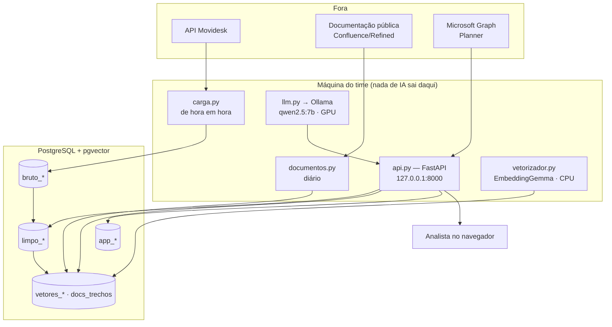

# Arquitetura

Como o projeto é organizado, por onde o dado passa e onde cada coisa roda.

## Visão geral

## Camadas do dado

O banco é um só; o que separa as camadas é o **prefixo da tabela**, não o schema. A regra é que uma
camada só lê da anterior.

| Prefixo | Papel | Quem escreve |
|---|---|---|
| `bruto_` | O retorno da API exatamente como veio (`jsonb`). Nunca é alterado pelo tratamento. | `carga.py` |
| `limpo_` | Tipos corretos, fuso aplicado, uma linha por ticket / mensagem / problema / solução. | `sql/002`–`sql/007` |
| `vetores_`, `docs_` | Embeddings dos problemas e dos trechos da base de conhecimento. | `vetorizador.py`, `documentos.py` |
| `app_` | Estado do produto: usuários, sessões, rascunhos, feedback, configuração, acessos, cards. | a API |

**Por que ELT e não ETL.** A API do Movidesk só devolve a versão atual de cada ticket: não dá para
voltar no tempo. Guardar o retorno original permite refazer o tratamento inteiro a partir do banco
quando uma regra mudar, sem depender da API nem de um backup externo. O custo é guardar o `jsonb`
duas vezes; o benefício é que nenhuma decisão de tratamento é irreversível.

**Por que o tratamento é SQL e não Python.** O trabalho é relacional (juntar, achatar, tipar, agregar)
e o banco faz isso melhor e sem trazer os dados para a aplicação. Cada arquivo roda numa transação;
se falhar, a versão anterior continua valendo.

**Por que as checagens param o pipeline.** `sql/004_checagens.sql` devolve uma linha por checagem com
uma contagem de problemas. Qualquer contagem acima de zero encerra a execução com erro, e o registro
fica em `execucoes_pipeline`. É melhor ficar sem dado novo do que servir dado errado ao analista.

## Componentes

### Pipeline (`carga.py`)

Busca → grava bruto → roda os `.sql` em ordem → gera os vetores que faltam → confere → registra a
execução. É idempotente: a gravação é um upsert que só substitui quando a versão recebida é mais
nova, e os vetores só são gerados quando o `md5` do texto ou o nome do modelo mudam.

### Acesso ao banco (`banco.py`)

A única parte do projeto que abre conexão. Pool (`psycopg_pool`) com tempo limite de 10 s — sem ele,
uma rede instável segura a carga por horas. Todo SQL da aplicação é parametrizado.

### Busca

Duas buscas somadas no Pergunte:

- **Significado:** embedding da pergunta (`EmbeddingGemma`, 768 dimensões) contra `pgvector` com
  índice HNSW e distância de cosseno.
- **Palavras:** BM25 em `lexico.py`, com stemming em português.

A busca por ticket parecido não usa o LLM nem a pergunta do usuário: compara o embedding do problema
do ticket atual com o dos tickets já resolvidos.

### Triagem (`triagem.py`)

kNN puro: os 10 tickets resolvidos mais parecidos, do mesmo produto, votam em categoria, urgência e
risco de SLA. Não há modelo treinado, de propósito — o conjunto é pequeno, muda de distribuição ao
longo do tempo e o kNN dá uma explicação pronta ("esses são os casos em que me baseei"), que é o que
o analista precisa para confiar ou descartar a sugestão.

A confiança é a concordância dos vizinhos, e a tela só destaca a sugestão quando ela é alta, porque a
[avaliação](avaliacao_triagem.md) mostrou que o ganho sobre a linha de base está concentrado ali.

### Geração (`copiloto.py`, `geracao.py`, `llm.py`)

O LLM roda local (Ollama). `geracao.py` é uma fila de um pedido por vez: a GPU não comporta duas
gerações, e quem está esperando na tela passa na frente da pré-geração em segundo plano. A resposta
chega em streaming, para a primeira palavra aparecer em ~2 s em vez de a tela ficar parada 30 s.

O prompt recebe só o que veio da busca, com os dados pessoais já mascarados por `privacidade.py`, e a
resposta é obrigada a citar a fonte — sem fonte, o copiloto diz que não encontrou.

### API e telas (`api.py`, `static/`)

FastAPI servindo JSON e uma aplicação web em HTML e JavaScript sem framework. A fila aberta (tickets,
vizinhos, rascunhos) não é consultada a cada requisição: vive num **retrato em memória** atualizado
por uma thread a cada 2 min, já que a carga é de hora em hora. É daí que vem a queda de 5,6 s para
dezenas de milissegundos na tela da Fila.

`medicao.py` cronometra cada requisição separando banco, vetor e LLM, e devolve isso no cabeçalho
`Server-Timing` além de gravar em `logs/desempenho.jsonl`.

## Segurança

| Risco | Como é tratado |
|---|---|
| Credencial no repositório | Tudo vem do `.env`, que está no `.gitignore`. O token tem `repr=False` na configuração e nunca entra em mensagem de erro. |
| Senha de usuário | `scrypt` com sal aleatório por usuário; comparação com `hmac.compare_digest`. |
| Roubo de sessão | Token de 32 bytes aleatórios; o banco guarda só o `sha256`. Cookie `HttpOnly`, `SameSite=Lax`, `Secure` fora do localhost, 12 h. Trocar a senha encerra as outras sessões. |
| Acesso indevido a rota | Toda rota depende da sessão; as destrutivas exigem papel `gestor` ou `admin`. |
| Dado pessoal no LLM | `privacidade.py` mascara e-mail, CPF, CNPJ, telefone e o nome na saudação antes de exibir ou enviar. |
| Senha de cliente no banco | Cifrada com Fernet; a chave fica fora do banco, e cada revelação vira linha em `app_acessos_log`. |
| Travessia de caminho no download | O caminho é resolvido e precisa estar dentro da pasta da base; HTML sai como `attachment` com `nosniff`. |
| Exposição da API | Escuta em `127.0.0.1`. No container, `0.0.0.0`, mas o compose só publica a porta no loopback. Quem expõe é o túnel ([ADR 0002](adr/0002-hospedagem.md)). |

## Onde cada coisa roda

| Peça | Onde | Por quê |
|---|---|---|
| PostgreSQL + pgvector | banco gerenciado na nuvem | já existia; evita manter banco em máquina de desenvolvimento |
| Embeddings | CPU da máquina local | 2 GB de RAM; a GPU fica livre para o LLM |
| LLM | GPU da máquina local | nenhum texto de ticket pode ir para um serviço externo |
| API e telas | mesma máquina | MVP; o container deixa a migração para servidor ser só uma mudança de host |
| Pipeline agendado | Agendador do Windows ou `agenda.py` no container | não roda em CI: os logs de um runner público mostrariam dados de clientes |

## Testes

91 testes que não tocam banco, API nem modelo — tudo por dublês. O que eles cobrem é a lógica que
erra em silêncio: paginação e novas tentativas da API, o filtro incremental da carga, o cálculo dos
vizinhos, o mascaramento de dados pessoais, o divisor de trechos, o parser da documentação pública,
a cifra dos acessos e o casamento dos cards com os tickets.

## O que eu faria diferente

- **As checagens rodam depois de substituir as tabelas.** O certo é tratar numa tabela temporária,
  conferir e só então promover. Hoje, uma falha de checagem deixa o dado ruim visível até a correção.
- **O tipo do ticket (interno ou público) não é coletado**, porque tickets internos são raros.
  Corrigir exigiria reprocessar o histórico.
- **A autenticação não tem limite de tentativas** além de um atraso fixo no login. Uma trava por
  e-mail e por IP é o próximo passo antes de qualquer exposição mais ampla.
